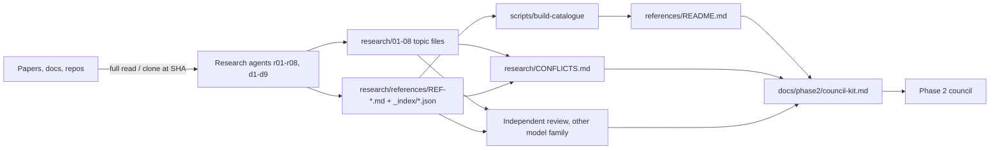
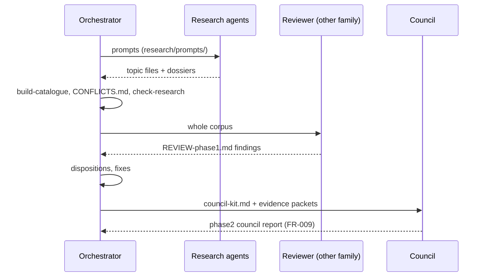

# TRD: code-verification-lean4

<!-- id: TRD-code-verification-lean4 · implements: PRD-code-verification-lean4 · status: active (Phase 1b) · authors: coding agent for Profit Rise Consulting -->

## 1. Abstract

This document describes how the research programme is produced and checked. Agents gather evidence into topic files and reference dossiers under fixed conventions. A generator builds the reference catalogue, and stdlib-Python gates in CI enforce the evidence standard and the handoff package. The Phase 2 council consumes the result. No Lean toolchain is part of the repo until Phase 3.

## 2. Context and Scope

In scope: the Phase 1 and 1b evidence pipeline, its validation, and the interface to the Phase 2 council. Out of scope: any verification tooling, which is decided after the council ([ADR-0002](docs/adr/0002-research-first-scope.md)).

## 3. Goals and Non-Goals

**Goals**

- Every PRD requirement is machine-checked in CI.
- Evidence is reproducible by URL plus access date, or by repo plus commit SHA.

**Non-Goals**

- Running third-party proofs. They are deferred to a Phase 3 CI reproducibility job.

## 4. Requirements Traced

| Req ID | Requirement (MUST) | Design section | Screen | Task(s) | Test | Issue | Status |
|---|---|---|---|---|---|---|---|
| FR-001 | Hypothesis verbatim plus sub-claims | §6.2 | — | — | `scripts/check-research` FR-001 | — | done |
| FR-002 | Depth headers and excerpt quarantine | §6.2 | — | — | `scripts/check-research` FR-002 | — | in progress |
| FR-003 | 15-section dossiers plus index JSON | §6.3 | — | — | `scripts/check-research` FR-003 | — | in progress |
| FR-004 | Generated catalogue | §6.3 | — | — | CI step "Catalogue is current" plus FR-004 check | — | in progress |
| FR-005 | Conflict sections and register | §6.2 | — | — | `scripts/check-research` FR-005 | — | in progress |
| FR-006 | Council kit | §6.4 | — | — | `scripts/check-research` FR-006 | — | in progress |
| FR-007 | Handoff package | §6.4 | — | — | `scripts/check-research` FR-007 | — | in progress |
| FR-008 | Independent review with dispositions | §6.4 | — | — | `scripts/check-research` FR-008 | — | not started |
| FR-009 | Council report | §6.4 | — | — | Phase 2 gate (to be added) | — | not started |
| FR-010 | Phase 3 pilot | — | — | — | Phase 3 gate (to be added) | — | not started |
| NFR-001 | No excerpt-only evidence | §7.2 | — | — | `scripts/check-research` NFR-001 | — | in progress |
| NFR-002 | Public repo security hygiene | §7.3 | — | — | Security workflow (CodeQL, zizmor, trufflehog) | — | done |
| NFR-003 | Relative links resolve | §7.4 | — | — | `scripts/check-research` NFR-003 | — | in progress |

## 5. Architecture Overview

Agents read sources in full and write topic files and dossiers under research/CONVENTIONS.md. The catalogue and conflict register are aggregations, and a reviewer from another model family audits the whole corpus. The council kit packages it all into evidence packets per sub-claim.

## 6. Detailed Design

### 6.1 Runtime & Deployment Topology

Static Markdown and JSON in Git. CI runs on GitHub-hosted `ubuntu-latest` with system Python 3. No runtime service.

### 6.2 Public API / Contracts

The contract is research/CONVENTIONS.md: sub-claim IDs, evidence depth tags [FULL]/[CODE], primary/secondary tags, quarantine of unverified leads, and the conflicts rule.

### 6.3 Data Model & Storage

- Dossier: `research/references/REF-<L|C><NN>-<slug>.md`, following [TEMPLATE.md](research/references/TEMPLATE.md) (15 sections).
- Index: `research/references/_index/REF-*.json`, following [SCHEMA.json](research/references/_index/SCHEMA.json). This is the machine-readable input to the catalogue.
- IDs are never renumbered. L = Lean reference, C = comparator.

### 6.4 Key Flows & Sequence Diagrams

### 6.5 Configuration, Secrets & Bindings

None. The repo needs no secrets. Tokens for GitHub Actions are the default `GITHUB_TOKEN` at least privilege.

### 6.6 Degree of Constraint

Rigid: the evidence rules, the sub-claim IDs and the dossier sections. Open: dossier depth beyond the template, and which extra references Phase 2 adds.

## 7. Non-Functional Requirements

### 7.1 Performance Efficiency

CI gates run in seconds (stdlib only).

### 7.2 Reliability

NFR-001: `scripts/check-research` scans every topic file above its Unverified leads heading for excerpt markers and fails on any hit.

### 7.3 Security

NFR-002: actions are pinned to full SHAs, `persist-credentials: false`, workflow permissions start at `contents: read`, CodeQL covers actions and python, zizmor audits the workflows, and trufflehog scans for secrets.

### 7.4 Flexibility

NFR-003: relative-link check across all Markdown. The generator design means new dossiers need only a JSON file.

### 7.5 Compliance & Data-Protection Constraints

Only public sources. Quotes are short, attributed and used for research commentary.

### 7.6 Observability

`scripts/check-research --output json` gives per-file FULL/CODE counts for tracking.

## 8. Alternatives Considered

| Option | Pros | Cons | Why not chosen |
|---|---|---|---|
| Single long research document | Simple | Unreviewable, no per-reference structure | Debaters need addressable evidence |
| Allow labelled excerpts | More coverage | Owner rejected it as not useful | [ADR-0003](docs/adr/0003-full-read-evidence-standard.md) |
| Build every reference repo locally | Strongest evidence | 20 GB disk exhausted in practice | Deferred to CI job |
| One model family for agents and council | Cheaper | Shared priors, weak debate | [ADR-0004](docs/adr/0004-council-model-diversity.md) |

## 9. Cross-Cutting Concerns

Cost: agent runs are credit-limited, so agents now save files incrementally. Bias: the comparator dossiers and the cross-family review counter Lean-favouring sources.

## 10. Test Strategy

| Layer | Scope | Tooling | Gate |
|---|---|---|---|
| Static | spine headings, ID formats, traceability | `scripts/check-docs` | CI blocking |
| Corpus | FR-001 to FR-008, NFR-001, NFR-003 | `scripts/check-research` | CI blocking |
| Freshness | catalogue matches index JSON | `scripts/build-catalogue` + `git diff --exit-code` | CI blocking |
| Security | workflows, code, secrets | CodeQL, zizmor, trufflehog | CI blocking |

Run all locally with `scripts/test`.

## 11. Rollout, Migration & Rollback

Phase 1b lands on branch `phase1b-wip` and merges to `main` only when `scripts/test` exits 0. Rollback is a git revert. `main` keeps the Phase 1 first pass until then.

## 12. Open Questions & Risks

See PRD section 13 and [phase1-research.md](phase1-research.md) Known limits.

## 13. Decisions

| ADR | Title | Status |
|---|---|---|
| [ADR-0001](docs/adr/0001-record-architecture-decisions.md) | Record architecture decisions | accepted |
| [ADR-0002](docs/adr/0002-research-first-scope.md) | Research-first scope, no toolchain until Phase 3 | accepted |
| [ADR-0003](docs/adr/0003-full-read-evidence-standard.md) | Full-read evidence standard | accepted |
| [ADR-0004](docs/adr/0004-council-model-diversity.md) | Council model-family diversity | accepted |

## 14. References

**Normative**

- [research/CONVENTIONS.md](research/CONVENTIONS.md)
- [docs/handoff/original-requests.md](docs/handoff/original-requests.md)

**Informative**

- [research/references/README.md](research/references/README.md)
- [docs/handoff/decision-log.md](docs/handoff/decision-log.md)

## 15. Change Log

| Date | Change | Author |
|---|---|---|
| 2026-11-07 | Research-programme TRD (Phase 1b) | coding agent for Profit Rise Consulting |
